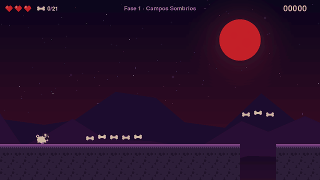
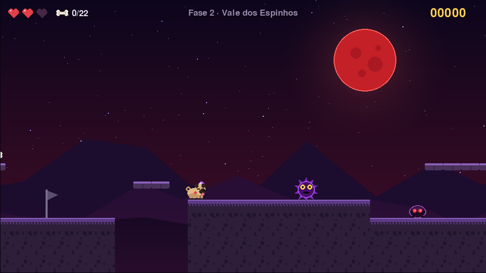
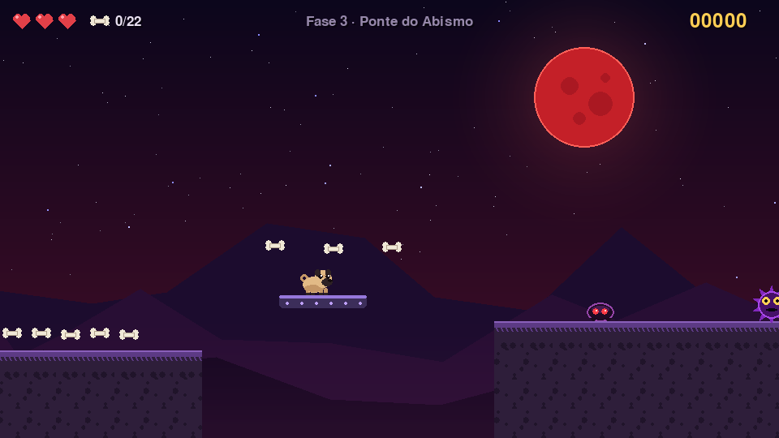
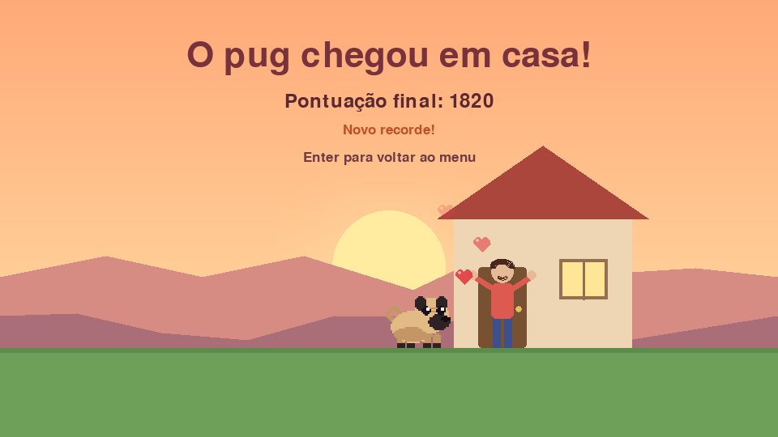

<div align="center">

# 🐾 Pug e a Lua Vermelha

**Um jogo de plataforma 2D sobre um pug que precisa voltar para casa**

Três fases sob uma lua vermelha, com inimigos, espinhos, plataformas que se movem e ossos para coletar. Toda a arte e todos os sons são gerados por código: o jogo não usa nenhuma imagem ou áudio externo.


<sub>Computational Thinking with Python · FIAP · Engenharia de Software</sub>



</div>

---

## A história

Numa noite em que a lua ficou vermelha, um pequeno pug se perdeu longe de casa. Entre campos sombrios, vales cheios de espinhos e pontes sobre o abismo, criaturas da noite rondam o caminho. Do outro lado, o dono espera na porta, de braços abertos.

---

## Como jogar

| Tecla | Ação |
|---|---|
| ← → ou A D | Andar |
| Espaço, ↑ ou W | Pular (segure para ir mais alto) |
| P ou Esc | Pausar |
| Enter | Confirmar |

- **Ossos** valem pontos, e cada fase esconde um **osso dourado** em um lugar mais difícil.
- **Pule em cima das sombras** para derrotá-las. Já o **cuspidor roxo** é cheio de espinhos: desvie dele e das bolas que ele lança em arco.
- As **bandeiras** são checkpoints: se o pug cair num buraco, ele volta para a última bandeira.
- O pug tem **3 corações** por fase. Terminar rápido dá **bônus de tempo**, e o recorde fica salvo.

---

## Fases

| | |
|---|---|
|  |  |
| **Vale dos Espinhos:** cuspidores, sombras e espinhos no chão | **Ponte do Abismo:** plataformas móveis sobre buracos enormes |

1. **Campos Sombrios:** apresenta os pulos, os buracos e as primeiras sombras.
2. **Vale dos Espinhos:** entram os cuspidores e os espinhos.
3. **Ponte do Abismo:** plataformas que se movem e todos os inimigos juntos.



---

## Destaques técnicos

- **Física com "game feel":** aceleração e atrito, pulo de altura variável, *coyote time* (ainda dá para pular logo depois de sair da beirada) e *jump buffer* (um pulo apertado um pouco antes de tocar o chão é guardado).
- **Colisão por eixo** com o mapa de blocos, plataformas finas que só seguram quem vem de cima e plataformas móveis que carregam o pug.
- **Câmera suave** com *parallax* em três camadas de montanhas e tremor de tela ao levar dano.
- **Fases definidas em texto:** cada fase é um mapa de caracteres em [`jogo/fases.py`](jogo/fases.py), fácil de ler e de editar.
- **Inimigos com comportamento próprio:** as sombras patrulham e viram nas paredes e beiradas, e o cuspidor calcula o arco da bola para acertar onde o pug está.
- **Arte procedural:** o pug (com animações de correr, pular, cair e piscar), os inimigos, o cenário e a cena final são desenhados com formas do Pygame.
- **Sons sintetizados:** os efeitos são ondas geradas em código. Se o computador não tiver saída de som, o jogo roda em silêncio.
- **Máquina de estados** para menu, introdução da fase, jogo, pausa, fim de fase, game over e vitória.

---

## Como executar

Requer **Python 3.10 ou superior**. O jogo usa o [Pygame CE](https://pyga.me), a versão mantida pela comunidade do Pygame, que já tem suporte às versões mais novas do Python.

```bash
git clone https://github.com/SofiaHagio/Jogo-do-Pug.git
cd Jogo-do-Pug
pip install -r requirements.txt
python main.py
```

---

## Estrutura

```
Jogo-do-Pug/
├── main.py             # Ponto de entrada
├── jogo/
│   ├── jogo.py         # Laço principal, estados, regras e desenho
│   ├── entidades.py    # Pug, inimigos, itens e partículas
│   ├── nivel.py        # Lê o mapa da fase e responde às colisões
│   ├── fases.py        # As três fases em texto
│   ├── arte.py         # Toda a arte, desenhada em código
│   ├── som.py          # Efeitos sonoros sintetizados
│   ├── recorde.py      # Recorde salvo na pasta do usuário
│   └── config.py       # Tela, física, cores e pontuação
├── docs/               # Imagens deste README
└── requirements.txt
```

---

## Equipe

| Nome | RM |
|---|---|
| Guilherme Tomé Nogueira | 570144 |
| Lucas de Andrade Astorini | 569119 |
| Sabrina Lopes da Silva | 571870 |
| Sofia Satomi Hagio | 569120 |
